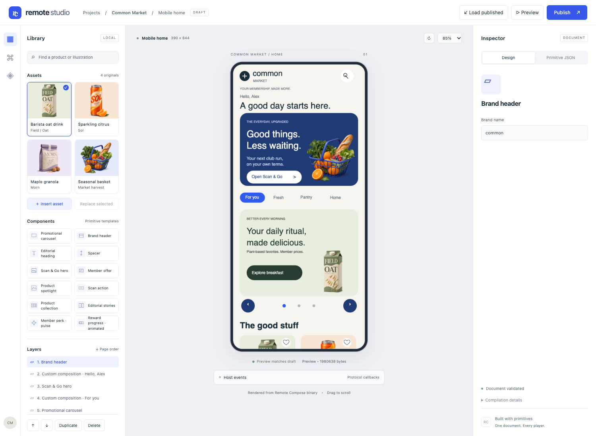
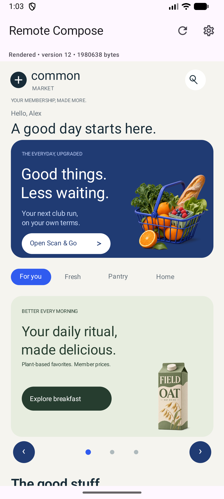
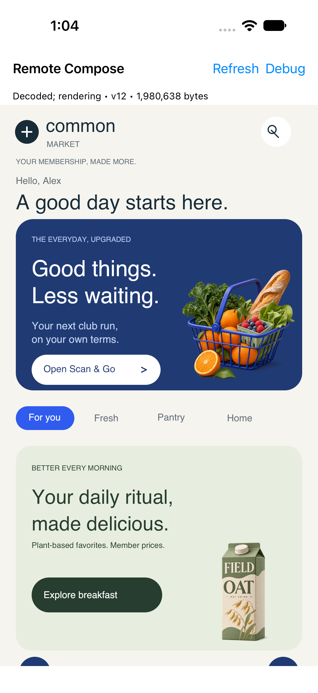
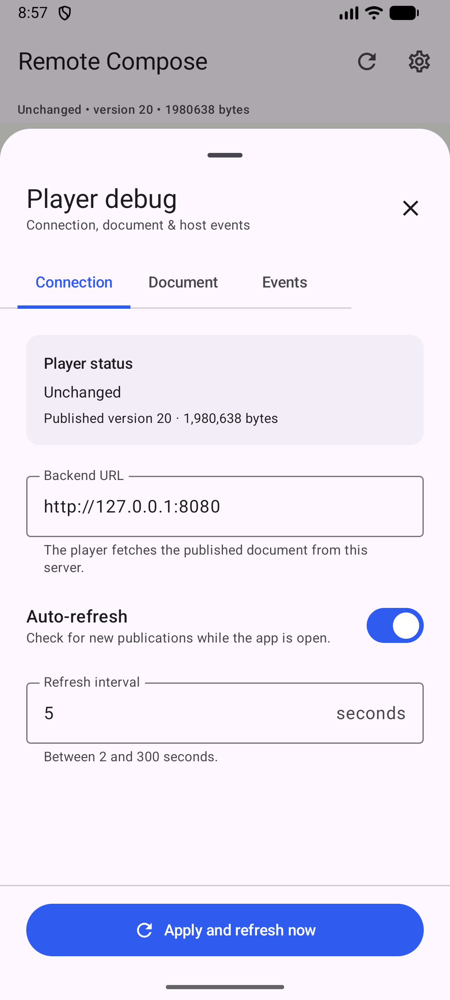
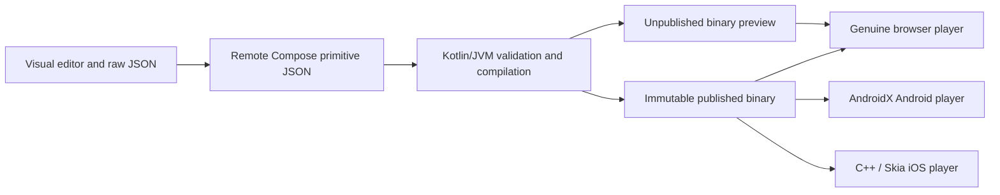
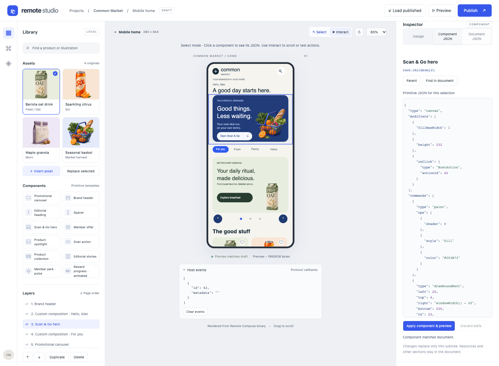

# Remote Compose Studio

A cross-platform visual authoring prototype built around **AndroidX Remote Compose**.
Create a retail page in the web editor, edit its primitive JSON, compile it on a Kotlin/JVM
backend, and publish one binary document to genuine browser, Android, and iOS players.

The server defines the composition. Editor templates generate layout, drawing, state,
animation, and interaction primitives; mobile clients contain general-purpose renderers.
New compositions using supported primitives can be published without rebuilding either
mobile application. New protocol capabilities may still require player updates.

## Screenshots

These are actual rendered captures from the [full-page validation](docs/evidence/full-retail/README.md),
not mockups. The browser preview renders JVM-generated Remote Compose bytes.

### Web editor

Asset library, component palette, page outline, phone preview, and property inspector.
The **Primitive JSON** tab exposes the editable document behind the design.



### Native clients

Both clients below render the **same published binary**. Refresh and Debug are native
player controls; the retail content is defined by the remote document. Screens retain
native safe areas and proportions; viewport heights and font metrics differ.

| Android emulator | iOS Simulator |
| --- | --- |
|  |  |

See the interactive product states on [Android](docs/evidence/full-retail/android-products-selected.png)
and [iOS](docs/evidence/full-retail/ios-products-selected.png), plus
[animation frames, event logs, and binary hashes](docs/evidence/full-retail/proof.json).

### Android debug bottom sheet

The native Android debug UI uses a Material 3 modal bottom sheet. **Connection** configures
refresh and the backend; **Document** shows the binary identity and viewport; **Events**
shows generic host callbacks. Settings remain drafts until **Apply and refresh now**.
Invalid settings leave the active configuration/document intact; closing discards drafts.



See [how to use it](docs/DEBUGGING.md#android-material-debug-sheet),
[how it works](docs/ARCHITECTURE.md#android-native-debug-sheet), and
[verified tests and limitations](docs/FULL_FEATURE_TEST_REPORT.md#android-material-debug-bottom-sheet--2026-11-04).

## What works

- **Visual authoring:** twelve templates, product asset browsing/replacement, section ordering,
  property editing, duplication where IDs permit, and deletion.
- **Primitive JSON editing:** editable source, syntax highlighting, strict validation and
  useful diagnostics. Custom compositions survive unrelated visual-editor operations.
- **Full retail design:** Common Market includes a Scan & Go hero, category pills, illustrated
  products, editorial stories, member perks, and animated rewards.
- **Protocol-local interactions:** independent product hearts, pressed Add feedback and
  `− quantity +` controls. A three-banner carousel slides automatically, wraps, and supports
  arrows, position dots, and offer callbacks. No platform-specific carousel timers.
- **Preview and publishing:** plain JVM compilation, separate unpublished previews, immutable
  published versions, metadata, ETags, and preservation of the last valid publication.
- **Generic native players:** manual/automatic refresh, loading/error states, native debug
  controls, document identity, and generic host-event feedback.

## Architecture



JSON is the source of truth. The widget catalog is an authoring tool, not a runtime business
component registry. The browser uses the experimental TypeScript player; iOS uses the
experimental C++ player through an Objective-C++/Swift bridge. Exact upstream revisions and
dependencies are recorded in [upstream-lock.json](upstream-lock.json).

## Quick start: backend and editor

Prerequisites: Git, Python 3, a JDK, Chrome, and network access for the first dependency
setup. The recorded development environment used JDK/JBR **25.0.4**, Node **22.14.0**, and
Gradle **9.2.1** on macOS arm64. Set `JAVA_HOME` to your JDK installation. The scripts
bootstrap the pinned Node and Gradle versions locally.

From the repository root:

```sh
python3 scripts/bootstrap-node.py
python3 scripts/fetch-upstreams.py
sh scripts/node.sh npm ci --prefix upstream/experiments/players/typescript
sh scripts/node.sh npm run bundle --prefix upstream/experiments/players/typescript
sh scripts/node.sh npm ci --prefix player-smoke
sh scripts/gradle.sh :pipeline:installDist
sh scripts/start-backend.sh
```

Open **http://127.0.0.1:8080**. The default is the full interactive Common Market design.
Saved custom drafts are preserved; **Reset to full retail design** explicitly restores the
bundled page. Choose **Preview**, then **Publish**, and refresh the native clients against
the same backend URL. Previewing a draft does not publish it.

The server stores local publications in ignored `data/documents`. Use `PORT` and
`RC_DATA_DIR` to run a separate local instance. A fresh checkout starts without published
versions; publish through the editor before opening a native viewer.

### Android and iOS

Follow [Getting started](docs/GETTING_STARTED.md) for SDK installation, emulator/Simulator
creation, build/install commands, networking, and tests.

| Client | Toolchain and connection |
| --- | --- |
| Android | JDK, Android SDK command-line tools, Gradle, `adb`, and Android Emulator. Android Studio is not required. Use `adb reverse tcp:8080 tcp:8080` for the local backend. |
| iOS | macOS, full Xcode, `xcodebuild`, `xcrun`, and an arm64 iOS Simulator. Simulator localhost reaches the Mac backend. Physical-device packaging/signing is not implemented. |

## Click a component to inspect its JSON

Choose **Select** above the phone, then click a component. The editor highlights its layer
and shows its exact **Component JSON**, including a source path. **Apply component & preview**
updates only that subtree; **Find in document** locates it in the full JSON. Use **Interact**
for buttons, favorites, carousel controls and scrolling. See the [demo walkthrough](docs/DEMO_GUIDE.md#inspect-and-edit-a-component).



## Validation

After installing dependencies, choose the quick regression or the comprehensive editor check:

```sh
sh scripts/verify-demo.sh
# Comprehensive check (includes verify-demo), isolated publishing and screenshots:
sh scripts/verify-editor.sh
```

For the full-page browser → publish → Android/iOS acceptance workflow, start an isolated
backend in one terminal:

```sh
PORT=8092 RC_DATA_DIR=data/interactive sh scripts/start-backend.sh
```

With both native viewers installed, an idle Android emulator and a booted iOS Simulator,
set `JAVA_HOME`, `ANDROID_HOME`, and `DEVELOPER_DIR` as described in the setup guide, then:

```sh
IOS_SIMULATOR=<booted-simulator-uuid> sh scripts/verify-full-retail.sh
```

This suite publishes test documents on port8092 and writes evidence to
`artifacts/full-retail`. It exercises the **complete bundled page**, including all three
products, real pointer interactions, scrolling, carousel navigation, and host events.

Recorded validation for implementation commit **`1b4ef0f`**: **85 JVM tests**, **16 model
tests**, twelve-template browser UI regression, and **27 expected interactions per player**
on browser, Android, and iOS. Actual native screenshots and live slide frames were inspected.
The same **1,980,638-byte** document rendered on all three players while native application
executable hashes remained unchanged. See the [test report](docs/FULL_FEATURE_TEST_REPORT.md)
for exact hashes, environment, fixes, initial failures, and the limits of this evidence.

## Repository and documentation

| Path / guide | Purpose |
| --- | --- |
| `web-editor/` | Editor, source-preserving model, authoring templates, genuine binary preview |
| `pipeline/` | Kotlin/JVM compiler, validation, HTTP backend, and publication storage |
| `android-player/`, `ios-player/` | Generic native viewers and UI tests |
| `samples/`, `assets/` | Primitive fixtures and original fictional product illustrations |
| `player-smoke/`, `scripts/` | Browser tests, CLI builds, diagnostics, and evidence capture |
| [Getting started](docs/GETTING_STARTED.md) | Setup and platform CLI instructions |
| [Demo guide](docs/DEMO_GUIDE.md) · [Interactive design](docs/INTERACTIVE_DEMO.md) | Presentation steps, local state, carousel timing, and event contracts |
| [Architecture](docs/ARCHITECTURE.md) · [JSON format](docs/JSON_FORMAT.md) · [API](docs/API.md) | Document pipeline, supported primitives, and HTTP endpoints |
| [Development](docs/DEVELOPMENT_GUIDE.md) · [Debugging](docs/DEBUGGING.md) | Extension points, testing, and troubleshooting |
| [Research](docs/RESEARCH.md) · [Compatibility](docs/COMPATIBILITY.md) · [Future architecture](docs/FUTURE_ARCHITECTURE.md) | Upstream findings, player limits, and caching research |
| [Design system](docs/DESIGN_SYSTEM.md) · [Artwork provenance](assets/PROVENANCE.md) | Visual conventions and asset origins |
| [Full test report](docs/FULL_FEATURE_TEST_REPORT.md) · [Screenshot evidence](docs/evidence/full-retail/README.md) | Measured behavior and actual rendered output |
| [AGENTS.md](AGENTS.md) · [Progress](docs/PROGRESS.md) · [Context](docs/CONTEXT.md) · [Decisions](docs/DECISIONS.md) | Portable development instructions and session handoff |
| [Third-party software](THIRD_PARTY.md) | Upstream attribution and dependency information |
| [Native layout fixes](docs/NATIVE_LAYOUT_FIX.md) | Viewport sizing, density conversion, app bars, and native regression checks |
| [Visual redesign](docs/VISUAL_REDESIGN.md) · [Demonstration review](docs/DEMONSTRATION_REVIEW.md) | Design iterations and earlier demonstration findings; dated evidence, not current certification |
| [Foundation compatibility](docs/COMPATIBILITY_FOUNDATION.md) | Historical minimal-pipeline compatibility investigation |
| [GitHub setup](docs/GITHUB_SETUP.md) | Private repository, remote transport, push authorization, and pre-push checks |
| [Primitive samples](samples/README.md) · [Validation fixtures](samples/validation/README.md) · [Android test assets](android-player/src/androidTest/assets/README.md) | Fixture purposes, generation, and validation scope |
| [Full validation evidence](docs/evidence/full-validation/README.md) · [Native layout evidence](docs/evidence/native-layout/README.md) · [Interaction evidence](docs/evidence/interactive/README.md) | Earlier recorded screenshot and cross-platform test runs |

Fresh editor evidence: [full acceptance screenshots and results](docs/evidence/editor-acceptance/README.md)
cover all 12 templates, 76 property edits, custom JSON, lifecycle failures and interactions.
This browser/backend run does not imply a fresh native rerun.

Latest feature evidence: [component selection, scoped JSON and native regression](docs/evidence/component-selection/README.md).

Inspector completeness: [Editorial stories fix and evidence](docs/evidence/editorial-stories/README.md).

Every tracked Markdown guide is linked from this README. `python3 scripts/check-project.py`
checks that coverage along with local documentation links. Historical reports preserve the
results of their recorded revision; [Progress](docs/PROGRESS.md) identifies the current state.

## Current limits

This is a technology prototype, not a production CMS or commerce application. Local cart
and favorite state resets when a new document is decoded; host events stand in for real
navigation. Category pills retain the original design and do not filter products.

Only a verified subset of the pinned protocol is enabled. Native font/ripple rendering
differs, and animation clocks are not synchronized across devices. Physical-device,
accessibility, broad screen-size, and performance certification remain open. Additional
independent interactive collections require explicit variable renaming in raw JSON.
See [Compatibility](docs/COMPATIBILITY.md) before assuming support for another operation.
