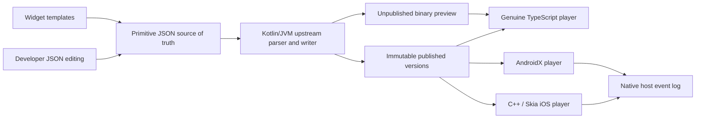
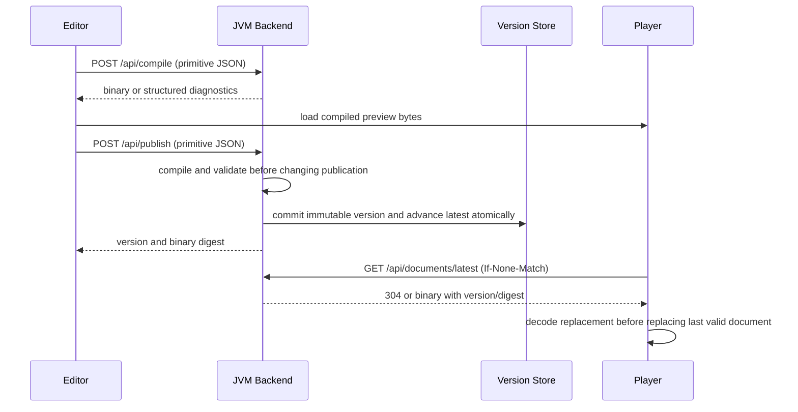
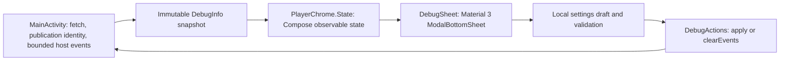

# Architecture

Implemented: Kotlin validation/compiler/HTTP publication, JSON-preserving browser editor,
Android official player and iOS C++/Skia Metal viewer. See API.md for the working contract.
The original CLI/static pixel gate remains as a small regression proof.

The server owns UI composition. Clients own protocol execution and a small native debug
shell. Business widgets exist only as editor templates that expand into upstream JSON.

## Implemented service contract

| Endpoint | Behavior |
| --- | --- |
| POST /api/compile | Isolated compilation; no published state mutation; binary response or JSON diagnostic |
| POST /api/publish | Compile first, allocate immutable version, atomically persist binary/source/metadata/latest |
| GET /api/documents/latest | Binary plus ETag/version; 304 support; 404 before first publication |
| GET /api/documents/latest/metadata | Published version, size, digest, protocol/profile and compiler revision |

Publication serializes a lock-protected immutable source/binary/metadata JSON bundle and
atomically renames it into the numeric version store. Latest is the highest committed
version. Binary responses carry version/digest; historical source/binary/metadata routes
are available. Compilation completes before touching publication storage.

## Editor preservation rules

Maintain the JSON tree itself, with selection/template hints in a sidecar. Section
operations should edit one array entry. Properties should patch only recognized fields
after structural recognition; raw changes that invalidate recognition become custom.
Never infer business node types in clients or regenerate the entire document from forms.
Definitions/resources must remain intact when editing sections. Duplicate operations
may contain IDs: implement safe remapping or reject unsafe duplication with a useful
message until namespace rules are verified.

## Runtime lifecycle

Fetch, decode, validate capabilities, then swap. Serialize refresh operations or discard
stale responses. Cancel timers when inactive; bound the event log. Keep native refresh,
configuration, errors and metadata usable even when document rendering fails.

Only allow host actions exposed by each player. Local variable changes do not qualify
as host-visible interactions. Unsupported protocol operations require explicit errors
or a documented capability restriction; they cannot become native business fallbacks.

## Document-local interactions

The interactive retail source composes variables, expressions, formatted numeric text,
canvas transforms and local expression-change actions. Rendering/state updates never
call the backend. Host events notify generic native/browser feedback shells; they do
not implement carousel state or business navigation. Native refresh scheduling remains
separate from document time. See INTERACTIVE_DEMO.md for the phase model and payloads.
The browser integration preloads nested immutable TextData, matching the generic iOS
bridge repair for interned action names; pins and wire format remain unchanged.

## Full retail default authoring

model.initialDocument() preserves the original complete retail composition and replaces
only the promotional area and product controls with stateful primitives. Generated
retail-home.json and interactive-retail.json are identical aliases. Each product declares
its own variables; a named products_scroll is declared before the horizontal row. No
mobile UI implementation or business component registry is involved. Inspector edits patch
recognized fields; custom action/layout changes fall back to source editing without loss.
See INTERACTIVE_DEMO and the full-page acceptance section of FULL_FEATURE_TEST_REPORT.

## Android native debug sheet

The Android debug controls belong to the native player shell, independently of remotely
authored content. The same sheet remains available when a fetch or decode fails.

- `MainActivity.showState()` copies settings, version, bytes, SHA-256, decoded header,
  viewport metrics, fetch status and the latest50 events into `DebugInfo`. Copying the
  event list lets Compose observe changes without sharing a mutable collection.
- `PlayerChrome` owns visibility. `DebugSheet` uses the existing Material3 1.3.2 dependency,
  standard modal dismissal, scrollable tabs and content, and keyboard/navigation insets.
  The sheet is removed from composition after closing; it does not replace the player view.
- Connection settings are a separate local draft. `rememberSaveableStateHolder` preserves
  that draft when switching tabs; incoming fetch snapshots do not overwrite it. Dismissing
  the sheet discards unapplied changes. Apply accepts HTTP(S) server URLs without credentials,
  query or fragment, plus a whole-number interval of2–300 seconds. Errors stay inline.
- `DebugActions.apply` persists valid settings, clears the ETag if the server changed,
  replaces the scheduled refresh cadence and calls the existing guarded refresh method.
  Fetch/decode failures continue to retain the last valid document. Native polling runs
  only while the activity is active; it does not drive document animations.
- Document metadata is selectable and scrollable. Events are generic ID/name/payload
  callbacks, shown newest first; Clear events empties the host log without changing
  document state. No retail-specific actions or widgets are implemented in the sheet.

Implementation: [DebugSheet.kt](../android-player/src/main/kotlin/demo/remotecompose/DebugSheet.kt),
[PlayerChrome.kt](../android-player/src/main/kotlin/demo/remotecompose/PlayerChrome.kt), and
[MainActivity.java](../android-player/src/main/java/demo/remotecompose/MainActivity.java).
See [usage](DEBUGGING.md#android-material-debug-sheet),
[tests and screenshots](FULL_FEATURE_TEST_REPORT.md#android-material-debug-bottom-sheet--2026-11-04),
and [decision029](DECISIONS.md#029--android-diagnostics-use-the-existing-material-3-compose-shell-2026-11-04).

## Canvas selection and component JSON

Selection is browser authoring UI, separate from Remote Compose rendering and host actions.
The default **Interact** mode preserves normal player input. **Select** captures pointer-down
before the player receives it, reads the decoded layout tree and reveals the selected source
subtree. It never sends a simulated native action or changes document IDs/binary operations.

`web-editor/selection.mjs` pairs the validated source tree with the pinned decoded layout tree,
checking primitive opcode and child counts. It handles the parser's typed/shorthand layouts,
root arrays, variable declarations and both TextLayout/CoreText representations. Coordinates
come from measured player bounds and live ancestor padding/scroll positions, with viewport
and ancestor clipping. Hit testing follows the player's paint order. A mismatch disables
canvas picking; Layers and full document editing remain available. Drafts must match the
compiled preview before picking can resume. This is a guarded adapter to the pinned player,
not a general protocol source-map guarantee.

`inspector.mjs` keeps a scoped input buffer until Apply, then patches only the selected path
in the authoritative primitive document and compiles through the existing JVM endpoint.
Malformed scoped JSON preserves the document. Source snapshots prevent applying an old
component buffer over newer full-document edits. Pending component drafts are stored separately
in localStorage and recovered after reload, while the last authoritative document is previewed.
They must be applied/discarded before changing selection, performing visual mutations or
publishing. Find in document walks JSON tokens to select the exact range without reformatting.

The selection rectangle is editor chrome outside the canvas, absent from exports and mobile
binary output. A canvas primitive may contain many shapes; selection exposes that primitive's
commands together rather than claiming each painted shape is a separate layout component.
Use Interact to scroll and return to Select to inspect the visible portion.
