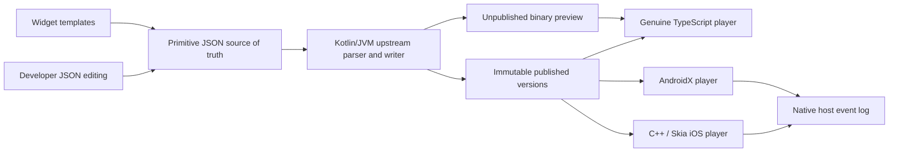
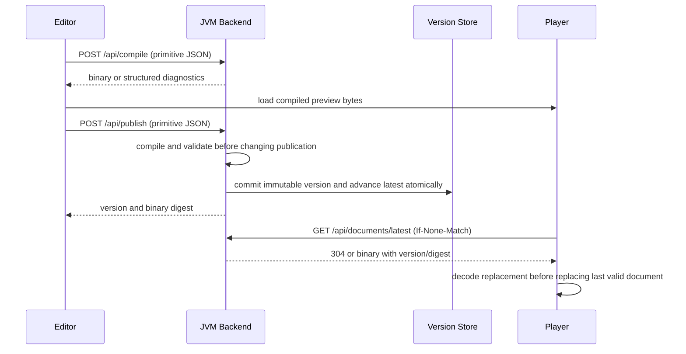

# Architecture

Implemented: Kotlin validation/compiler/HTTP publication, JSON-preserving browser editor,
Android official player and iOS C++/Skia Metal viewer. See API.md for the working contract.
The original CLI/static pixel gate remains as a small regression proof.

The server owns UI composition. Clients own protocol execution and a small native debug
shell. Business widgets exist only as editor templates that expand into upstream JSON.

## Implemented service contract

| Endpoint | Behavior |
| --- | --- |
| POST /api/compile | Isolated compilation; no published state mutation; binary response or JSON diagnostic |
| POST /api/publish | Compile first, allocate immutable version, atomically persist binary/source/metadata/latest |
| GET /api/documents/latest | Binary plus ETag/version; 304 support; 404 before first publication |
| GET /api/documents/latest/metadata | Published version, size, digest, protocol/profile and compiler revision |

Publication serializes a lock-protected immutable source/binary/metadata JSON bundle and
atomically renames it into the numeric version store. Latest is the highest committed
version. Binary responses carry version/digest; historical source/binary/metadata routes
are available. Compilation completes before touching publication storage.

## Editor preservation rules

Maintain the JSON tree itself, with selection/template hints in a sidecar. Section
operations should edit one array entry. Properties should patch only recognized fields
after structural recognition; raw changes that invalidate recognition become custom.
Never infer business node types in clients or regenerate the entire document from forms.
Definitions/resources must remain intact when editing sections. Duplicate operations
may contain IDs: implement safe remapping or reject unsafe duplication with a useful
message until namespace rules are verified.

## Runtime lifecycle

Fetch, decode, validate capabilities, then swap. Serialize refresh operations or discard
stale responses. Cancel timers when inactive; bound the event log. Keep native refresh,
configuration, errors and metadata usable even when document rendering fails.

Only allow host actions exposed by each player. Local variable changes do not qualify
as host-visible interactions. Unsupported protocol operations require explicit errors
or a documented capability restriction; they cannot become native business fallbacks.
