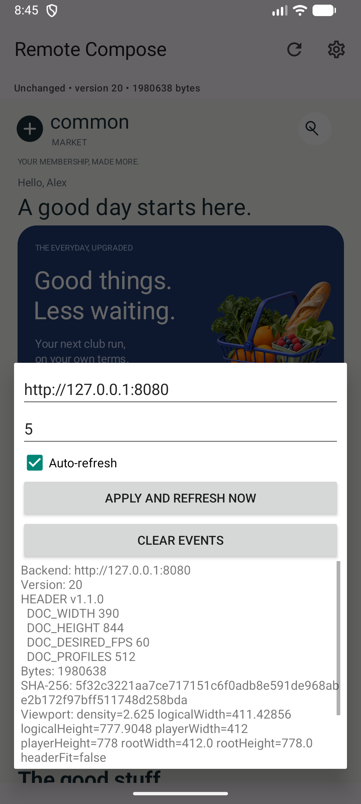
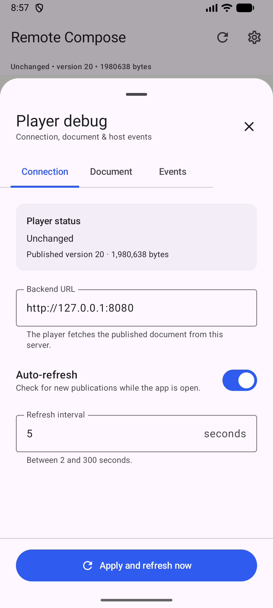

# Full feature and rendering validation

Latest: [Editorial stories inspector fix](#editorial-stories-inspector-fix--2026-11-04)
and [before/after evidence](evidence/editorial-stories/README.md).

Previous: [component selection and native regression](#component-selection-and-native-regression--2026-11-04)
and [screenshots/proof](evidence/component-selection/README.md). Earlier browser/native results
remain scoped to their recorded revisions.

> Native viewport follow-up: the manually found margins exposed a gap in this review's
> cropped-document screenshots. [NATIVE_LAYOUT_FIX](NATIVE_LAYOUT_FIX.md) records the
> corrected dp/point sizing, Android Material3 app bar, full-screen evidence and passing
> four-configuration regression suite. The older native390×844 pixel results below are
> historical and do not establish full native-container correctness.


Review date: 2026-11-03 (America/New_York). Baseline: `ed5ad06`; first fixes:
`6c66fb6`. The final evidence combines a successful29-document gallery with a targeted, corrected
lifecycle rerun; failed attempts remain in the evidence transcripts.
No upstream revisions changed, no remote push, no client business-component registry.

## Executive assessment

The tested editor-to-binary workflow is genuine. Actual browser controls author primitive
JSON; the JVM compiler publishes immutable bytes; browser, official Android and C++/Skia
Metal iOS viewers load those bytes. The browser preview is an upstream RcdPlayer canvas,
not DOM markup that imitates the document. Native shells contain fetch/debug/input code,
not product, banner, carousel or animation implementations.

This is a scoped engineering prototype, **not full protocol conformance or pixel parity**.
The review found and fixed real defects in immutable preview loading, image sizing,
clipping validation, named callbacks and startup. Remaining wheel, font/rasterization,
accessibility and physical-device gaps are explicit. A successful decode or event alone
is not treated as evidence that every visual or state transition worked.

## Recorded outcomes

- **31 immutable binary documents** rendered in browser, Android and iOS:11 modified
  widgets,18 custom/gallery documents and2 lifecycle publications. All31 Android full-hash
  assertions pass; XCTest verifies full native digests for the gallery and lifecycle.
- **81 JVM tests, nine model tests**, original109-byte pixel proof, browser editor/error
  regression, all20 property controls,18 complete custom-tree preservation checks pass.
- Android CLI assembly/unit/lint pass; **two instrumentation tests** cover real player
  input and refresh failure/corrupt-binary recovery. iOS build passes; gallery XCTest
  passes319.794s; the final strengthened lifecycle XCTest passes38.780s, including
  an actual offline viewport and a successful-response recovery assertion.
- **15 of62 strict cross-platform comparison rows retain ROI discrepancies**: bitmap
  filtering, thin animation edges and the edited circle edge. All10 native deterministic
  phase geometry checks pass; both live effects change on all three players. Text-region
  differences are reported separately, not passed by increasing thresholds.
- Reviewed static golden checks:27/27 initial checks; **24/24 independent repeat captures**
  pass for unchanged fixtures. Two earlier bad Android phase captures are correctly
  rejected as a negative control. The new clipping fixture is visually inspected on all
  three players; its baseline has no independent native repeat yet.
- `FULL_NATIVE=0 sh scripts/validate-all.sh` ran successfully end to end. Native stages
  were also executed separately with their actual CLI/instrumentation/XCTest results;
  a fresh one-shot native invocation after harness fixes has not been rerun in full.

Retail publication23: **1,970,167 bytes**, SHA-256
`e2c601547fc4eefab6dca6aa5d635442234e07bd015a6b4a0661769f09b454a2`.
The [complete31-document hash manifest](evidence/full-validation/proof.json),
[comparison metrics](evidence/full-validation/comparisons.json),
[live frame checks](evidence/full-validation/live-results.json) and
[independent golden repeat](evidence/full-validation/baseline-independent-repeat.json)
are portable evidence. Local raw bundles/xcresult remain in artifacts/full-validation.

Screenshots inspected:
[editor](evidence/full-validation/editor-retail.png),
[browser widgets](evidence/full-validation/widgets-browser.png),
[Android widgets](evidence/full-validation/widgets-android.png),
[iOS widgets](evidence/full-validation/widgets-ios.png),
[retail comparison](evidence/full-validation/retail-comparison.png),
[graphics](evidence/full-validation/graphics-comparison.png),
[bitmaps/bag](evidence/full-validation/bitmaps-comparison.png),
[typography/clipping](evidence/full-validation/layouts-comparison.png),
[animation states](evidence/full-validation/animation-phases.png).

## Environment and immutable dependencies

- Apple Silicon macOS; JBR25.0.4, JVM target17; Gradle9.2.1, Kotlin2.2.20, AGP9.0.0.
- Chrome156.0.8078.80; Playwright1.56.1; Node22.14.0; upstream Canvas2D player bundle.
- Android Emulator Medium_Phone_API_37.0, Android17/API37; SDK Build Tools36.0.0;
  default1080×2400, density420. CLI Gradle/adb only.
- Xcode27.2 build27B52; iPhone18Pro arm64 Simulator, iOS27.2; deployment target18.5;
  CMake3.31.6; Skia `m144-e2e6623374-4`. Simulator signing is ad hoc.
- AndroidX `8932b2c2b5043cc40c46a44cfd04a1671ec50fb7`.
- Experiments `a7a76f1d9ecc5aff2af93d0de570a11532552ea3`.
- Selected API7/profile512 primitive subset; see upstream-lock.json for full dependency
  pins. No assumption that other revisions/operations are compatible.

## Method and test matrix

The suite uses the existing Playwright, JUnit/AndroidX instrumentation and XCTest tools.
Browser tests operate real controls, not only the editor model. Each gallery document is
published once on isolated backend8091, downloaded and hashed, then selected by immutable
version in all three generic viewers. Android logs its full digest. XCTest reads the full
native digest accessibility value. Screenshots come from real canvases/adb/Simulator.
The iOS lifecycle publishes two additional documents and the other players fetch those
same immutable versions. No per-platform compilation is performed.

| Area | Observed coverage | Verdict |
|---|---|---|
| Widget controls | All11 widgets, all20 property controls, add/select/move/duplicate/delete; exact unrelated-JSON checks | Pass |
| Custom source | All18 generated custom fixture trees/resources preserved through real visual controls | Pass |
| JSON/errors | Malformed, unsupported, invalid properties, source editing/formatting, last-good preview/publication, offline/stale requests | Pass in JVM/browser suites |
| Large/empty |160-section browser document; empty fixture across players | Browser large; native long-scroll fixtures, not160 sections |
| Graphics | Circle/ellipse/rounded rect, alpha/color/gradient, cubic path/arc, save/clipRect/transform, nested layouts/overlap | Captures plus declared geometry/color checks; fonts separately reported |
| Assets | Four distinct transparent fictional PNGs, reference resolution, square/stretch destinations and legacy bag | Rendered on all players; filtering differences remain |
| Animations | Five deterministic protocol-variable phases and live time-driven badge/progress frames | Geometry/live observations; clocks are not synchronized |
| Interactions | Touch502/503, click501, named validation.echo/hello-protocol; separate local-state marker movement | Real input, host log and rendered marker checked |
| Native lifecycle | Manual/auto refresh, failed refresh, corrupt-binary retention/recovery on Android; draft/publish/manual/auto/offline on iOS | See final run status/evidence |
| Responsive | Browser390/768/1100/1500, zoom65/85/100%; Android small/large/font150%/landscape; iOS landscape capture | Fixed authored layout fits; not adaptive reflow |
| Scrolling | Pointer/touch, vertical/nested horizontal, native swipes | Browser wheel fails; real trackpad untested |
| Accessibility | Keyboard editor controls, contrast tokens, Android hierarchy/native debug; iOS native controls | Remote semantic coverage incomplete; no spoken screen-reader certification |
| Undo/redo | No controls exist | Not supported; not silently treated as tested |

Widgets: header, text, spacer, hero, promo, image, button, products, news, badge, progress.
Widget screenshots include a separate diagnostic footer line to make spacer/layout height
visible. Fixtures and test-only plans are in samples/validation; plans are not a UI protocol.

## Bugs, causes and repairs

1. **Load published recompiled source.** It could not prove byte identity. It now snapshots
   metadata, loads immutable source/binary and checks the exact hash; browser automation
   asserts no compile POST occurs during Load published.
2. **Image width distorted art.** Updating only the right bound changed aspect/center.
   The image-size form updates all four bounds, preserving aspect/center within the188px
   art frame. A model regression checks unrelated operations and invalid size rejection.
3. **Circle clip silently disappeared.** Parser parseShape accepts CircleShape, but pinned
   creation/modifiers/ClipModifier.write only emits RectShape/RoundedRectShape. The backend
   rejects circle clip at its JSON location. Supported roundRect radius50 in100×100 is
   exercised instead; it is a genuine emitted clip, not an HTML mask.
4. **Android named events were not subscribed.** The generic viewer now registers the
   CoreDocument ActionCallback as well as ID actions. Both event kinds reach its bounded log.
5. **iOS named event had empty name.** HostAction.write creates DATA_TEXT for the name
   inside the action list. The C++ action container skips that data pass. The bridge now
   preloads immutable text definitions recursively, without executing actions/drawing.
   XCTest asserts both name and string payload; all pins remain unchanged.
6. **iOS startup could cancel its initial fetch.** Scene activation and task start both
   restarted the same task. Start is now idempotent until stop; native gallery startup is
   tested repeatedly across immutable versions.
7. **Android stale failure/304 could overwrite changed-backend status.** Those paths now
   use the same backend guard as successful responses.
8. **Muted text contrast was too low.** Paper text was3.68:1 and a small editor label3.04:1.
   Corrected tokens are4.81:1 on paper and5.02:1 on white. This is a token measurement,
   not a claim that every pixel of artwork or every native control was audited.
9. **Capture harness sampled Android activity fade/old restored task.** It now waits for
   the actual expected hash and viewport, settles the launch, rereads viewport dimensions,
   and retries a mismatched launch once. Wrong hashes remain failures, not accepted shots.
   The first two exploratory runs retain their failed first-header capture records.

## Clipping, vectors, bitmaps and rendering differences

The old shopping bag is a120×120 opaque PNG with a flat handle cap in the **source**.
The gallery renders it at120×120 and at the old160×120 destination: the latter stretches
horizontally on every player. No extra canvas/player crop explains that flat cap. The new
artwork uses transparent, distinct products; the property repair prevents new accidental
aspect distortion. Explicit raw JSON stretching remains possible and is shown deliberately.
The earlier populated-length SVG-path encoding repair is preserved; the cubic-heart fixture
and line icons render as protocol paths on all players. General SVG import is not enabled.

Strict comparisons use declared thresholds: ROI mean RGB error≤5/255, fraction of pixels
with a channel error>12/255≤3%, solid interior channels±3, geometry±2 document pixels.
Failures are retained. Full-frame metrics are informational; text regions are explicitly
excluded from generic ROI gating and are **not** labeled visual passes. Same-platform
static golden checks are separate (mean≤1, fraction>12≤1%). No thresholds were raised to
make cross-platform captures pass. One-pixel-neighborhood diagnostics and8×8 luminance
SSIM help investigate edges; they do not override strict failures.

Bitmap filtering differs between browser Canvas2D and native Skia, compounded by native
physical-pixel capture normalization to390×844. C++ uses linear SkSamplingOptions; browser
uses its Canvas2D image-smoothing path. Solid colors and destinations match; detailed art
and edge pixels differ. Thin progress-bar pixel differences collapse in the one-pixel
edge diagnostic while analytic widths/radii agree. Live clocks are not used for equality.

Layout text is a larger unresolved difference: browser uses platform sans-serif Canvas2D
metrics, Android uses Android font metrics, C++/CoreText selects Helvetica Neue/Helvetica
fallbacks. The nested typography fixture exposes different baselines, line heights and
resulting sibling offsets. An embedded cross-platform font/metric policy is not implemented.
Do not present this fixture as pixel-equivalent. The retail composition uses explicit
geometries for most drawn copy, reducing but not eliminating font differences.

## Animation interpretation

The badge radius is `4 + 1.2*sin(time*3)` and progress width is
`185 + 24*sin(time*2)`, evaluated by player expression operations. The five phase documents
replace time with a protocol variable at0,π/4,π/2,π,2π; radius/width assertions compare
matching mathematical states across players, including loop-equivalent endpoints.
These companions are not a deterministic clock hook and do not prove real-time rate,
easing or dropped-frame parity. Live frames show both effects changing independently.
They loop continuously and have no terminal state. Host JavaScript/Swift/Java does not
animate the business content. Exact timing, sustained FPS and synchronized clock testing
remain future work.

## Usability and accessibility findings

The library, hierarchy, canvas and inspector are coherent at desktop sizes; narrow windows
stack/scroll panels without horizontal document overflow. Real rendered widget contact
sheets show distinctive art, clear retail hierarchy and consistent proportions. Remaining
limitations: no undo/redo, authored-size remote text, long JSON as a textarea/highlight
layer rather than a full code IDE, and pointer drag rather than wheel canvas navigation.
Product imagery/metadata are separate properties; swapping art does not rewrite copy.
Drawn hearts, filter tabs, search and editorial arrows are decorative unless their primitive
JSON defines an action. Product cards emit201–203 and scan surfaces42; this is an event
demonstration, not a cart, wishlist, search or checkout implementation.

Android UI hierarchy exposes some CoreText/scroll semantics, but drawn captions/buttons
are frequently unlabeled; virtual child bounds do not follow the scaled host viewport.
iOS Metal content has no generated document semantic tree. Native debug controls remain
separate and accessible to the automation APIs. Browser canvas is labeled as an image with
an explicit pointer/keyboard limitation; editor controls are keyboard-focusable and selected
layer/assets/modes expose pressed state. No VoiceOver/TalkBack spoken-output test, switch
control certification or full contrast/touch-target audit was performed.

The final offline iOS capture retains the same centerRGB(0,130,126) and the circle's
normalized extent within the predeclared±2px tolerance; Android checks a real retained
screen pixel and the recovered circleRGB(0,103,160). See
[retention metrics](evidence/full-validation/retention-results.json),
[offline viewport](evidence/full-validation/ios-offline-retained.png),
[named iOS event log](evidence/full-validation/ios-events.png), and
[Android events](evidence/full-validation/interactions--android.log).

## Remaining work and demonstration guidance

Use the reviewed portrait retail document and pointer/touch dragging for the engineering
demo. Keep native debug accessible, show full hashes, edit raw primitives and republish
without rebuilding. Do not claim arbitrary protocol support, pixel-identical fonts,
adaptive text, general SVG, shadows/elevation, external images or production accessibility.
Shadows/elevation are not enabled by the strict compiler subset; no substitute was drawn.

Next priorities: resolve font/metric policy and scaled semantic bounds; add a supported
wheel input path; synchronize native clocks for timing tests; test physical devices,
real trackpad gestures, VoiceOver/TalkBack and another clean checkout. Native network
coverage is finite; prolonged outages, signed-device packaging, resource exhaustion and
all cancellation races remain unverified. The upstream TypeScript typecheck failure is
unchanged and separate from the executed runtime bundle.

## Reproduction and evidence

See GETTING_STARTED and scripts/validate-all.sh. The script starts isolated backend8091,
keeps immutable version bundles and generates REPORT.md/summary.json plus raw captures,
logs/xcresult and heatmaps under artifacts/full-validation. Selected portable evidence and
same-platform baselines are tracked under docs/evidence/full-validation. Baselines must
be reviewed explicitly when fixture hashes change. No generated local SDK/config/signing
files, credentials or large runtime publication stores are tracked.

## Interactive carousel and raw JSON lifecycle — 2026-11-04

Executive result: the interactive retail document works through the actual editor,
JVM compiler, genuine browser player and both generic native players. Automatic rotation,
manual navigation, local shopping feedback and explicit host actions are protocol-driven.
A browser-authored new nested composition was published while both applications were
running, then refreshed at the identical hash without changing either installed binary.
See [interactive guide](INTERACTIVE_DEMO.md) and [18 actual screenshots/proof](evidence/interactive/README.md).
Implementation milestone: `bbdf2fc`; GitHub setup: `fdb1854`. Evidence/harness follow-up
is the subsequent local commit. No remote push.

### Environment and exact scope

Unchanged AndroidX8932b2c2b5043cc40c46a44cfd04a1671ec50fb7 and experiments
a7a76f1d9ecc5aff2af93d0de570a11532552ea3, API7/protocol1.1.0. JDK25.0.4,
Gradle9.2.1/AGP9.0.0/Kotlin2.2.20, Node22.14.0/Playwright1.56.1,
Chrome156.0.8078.80, Xcode27.2/arm64 iOS27.2. See upstream-lock.json for UI/Skia pins.
Android1080×2400, density2.625, measured stage1080×2042 at y295; logical root412×778
with ordinary outward dp rounding. iOS1206×2622 at3×, safe surface402×707.7pt.
The earlier four-size viewport validation is separate; this new interaction suite does
not claim exhaustive small-device/physical-device/fps/accessibility conformance.

### Executed validation

| Check | Result | Evidence / meaning |
| --- | --- | --- |
| JVM compiler/backend/parser | PASS85 tests | Added deterministic interactive encoding, strict textFromFloat and invalid expression-ID tests |
| Editor model | PASS12 tests | Count/order retain banners and customized event IDs; unknown trees remain custom |
| Existing real browser editor regression | PASS12 templates | Add/property/reorder/delete and safe-duplicate rejection; original image/animation/error checks retained |
| Interactive browser lifecycle | PASS | Text/color/dimension/layout/vector source edits; preview/publish exact digest;18 expected named events |
| Custom raw structures | PASS18 complete fixtures | Real Apply, tab switching, unrelated property/reorder/duplicate/delete preserve whole trees/resources |
| Invalid JSON/operation/value | PASS | Diagnostics; previous valid preview/publication retained; drafts stay unpublished |
| Carousel inspector | PASS | Text/assets/colors/order, intervals, visibility,2/3/4/5-slide compilation and JSON round trips |
| Local-state/rapid-input browser test | PASS37 events | Heart/category/count pixels change; quantity floor0/peak12;8 rapid carousel clicks;0 backend requests |
| Animation clock gallery | PASS + visually inspected | Genuine player frames at4.55/4.775/5s show smooth translated/clipped neighboring offers |
| Nested action-resource minimal reproduction | PASS | Unadapted null name reproduced; generic data-only shim restores exact name/payload |
| Original minimal binary proof | PASS |109 bytes, unchanged3 browser pixel checks |
| Android CLI build/unit/lint | PASS | Material3/native shell and official renderer retained |
| Android instrumentation | PASS5 cases | Actual pointer input, one event per click, local state/pixels, auto wrap, resume, existing refresh/failure and viewport checks |
| iOS combined UI tests | PASS2 methods | Immutable binary digests, all17 interaction events without duplication, exact local payloads, resume quantity, selected-heart pixels |
| Live JSON publication | PASS1 additional iOS method + Android/browser driver | Running clients6→7; manual toolbar refresh; exact digest; generic promotion event; installed executable hashes unchanged |
| Single-command focused suite | PASS | scripts/verify-interactive.sh end to end, artifacts/interactive-suite-final.log; summary report.json |

Browser tests operate the visible source textarea, Apply, properties, outline, Preview,
Publish and Load published controls. They are not model-only tests. The new custom source
contains nested layouts, vector circles/hearts, embedded bitmap artwork, text, actions,
float variables and time expressions. There is no compiler widget registration. The
editable carousel remains recognized after safe changes; structurally altered sections
fall back to a preserved custom representation. Application-level undo/redo is unavailable.

### Exact shared documents and running-client proof

The main combined suite published each source once and selected that immutable version
in all three players. No platform-specific recompilation occurred:

| Local version | Document | Bytes | SHA-256 |
| --- | --- | --- | --- |
|4 /6 | Interactive original / final |1,246,432 | `33a179579d073f31fd3cf281072efcf2dce99bb558dc6f991085d7b3c5709c77` |
|5 | Raw-JSON edited nested composition |1,246,670 | `a574d9eb8dced9052bf29bfeadcfc2bf0de412730ab7936d6e1281bab45ec518` |
|7 | Live browser-authored section, native refresh |1,246,676 | `a91ef946aee361fb1af714d4f98790c5f87f719c221ed69e8d161bd8ebe9e3b0` |

In the additional live test, both apps were already running at6. Through the real browser,
a new row/text/vector section was authored, compiled and previewed while6 remained published.
Publishing7 updated Android and iOS through native Refresh, with generic promotion.open
callbacks from the new composition. Installed binary hashes before and after:

- AndroidAPK: `a10143b723ed39c72497c788b199b1e30f9ed78c16ebbe6d97e513b7148b30b4`.
- iOS executable: `22ade2cb0ec06ac7f577cf538640eb1f26a52b45828320314ba19254ece8a425`.

Both hashes were read from the installed applications, not merely assumed from build paths.
The full raw source, operation IDs and exact downloaded bytes remain separate from test
manifest metadata. Publication numbers are local run state and can differ on another machine.

### Interactions and rendering observations

All arrows/dots/banner CTAs, favorite, categories, quantity controls, product illustration/
title, Scan & Go and membership links have explicit behavior in this fixture. Favorite,
category and quantity changes are immediate local opcode227 writes, with numeric text
formatted in the protocol. Generic hosts show/log the action name and float/string payload.
Automatic rotation is one continuous expression phase; no carousel timer exists in JS,
Android or Swift. Manual changes reset the phase epoch and retarget from the current
fractional position. Three dots highlight the nearest active slide; wrap3→1 is verified.

Native callback number strings differ (`1`, `1.0`, `1.000000`) while numeric values match.
The visible heart fill, category selection and quantity were inspected on actual native
screens. Native time is live; browser pinned frames establish deterministic transition
geometry without pretending that unsynchronized native screenshots share a phase. Remote
font metrics differ, as recorded in the previous report. Newly added source can extend the
page below the viewport; ordinary vertical scrolling is intentional, not a side margin.

### Bugs found and fixed

| Defect / layer | Cause and correction |
| --- | --- |
| Browser indicator host name null | Interned DATA_TEXT nested under a different unclicked action list; generic recursive text-only initialization, matching existing C++ shim. Minimal reproduction retained. |
| All dots appeared similarly translucent | Opaque paint color was applied after alpha; apply color before expression alpha. Rendered initial/mid/final indicators inspected. |
| Android feedback displayed stale actions | Toast queue accumulated during rapid clicks; cancel previous Toast and clean up on destroy. Latest generic feedback remains current. |
| Count edits reset configured control action names | Inspector rebuilt recognized controls without copying names; copy existing arrow/dot identifiers and add regression test. |
| Literal expression action could encode invalid ID | Pinned writer expects NaN expression reference; strict validation now rejects literals with property path and suggests ValueFloatChange. |
| Timing test assumed zero decode cost | Native bitmap decode can consume first interval; explicitly select a known slide/reset timestamp before assertions. No runtime capability was disabled. |
| iOS resume test tapped outside surface | XCTest briefly reported transition-sized geometry; wait for stable full-width frame before normalized input. Screenshot/state established retained quantity, and strengthened rerun passed. |

Early failed test runs are retained in ignored local artifacts. Final main runner and live
workflow passed; no thresholds were loosened or host widgets substituted to obtain success.

### Remaining limitations and next actions

- State lasts only for the decoded document session; persistence across new publications,
  business navigation, checkout and user accounts are deliberately absent.
- Inspector supports2–5 slides and one default variable namespace. Additional independent
  carousels need explicit raw-JSON namespace renaming. Long-copy editing can overflow fixed
  authored frames. Grouping the many inspector fields would improve usability.
- The first interval includes decoding; resume catches up to elapsed phase. Native frame-rate,
  energy use and synchronized animation clock comparisons remain unmeasured.
- The old static designed-page sample still has decorative controls; choose **Load interactive
  demo** for the fully behavioral acceptance fixture. It was preserved for regression history.
- General functions/conditional operation blocks exist in broader pinned source but remain
  outside this service capability subset. No newer Summit capability was assumed supported.
- Physical-device, signing, remote accessibility and strict cross-player typography differences
  remain as previously documented. The new suite does not erase earlier strict pixel flags.
- GitHub is private with origin configured; no commits pushed. Limited tracked-file key/token
  pattern checks passed. Renew content/history secret review before any authorized future push.

## Default editor design follow-up — 2026-11-04

The interactive composition is now the fresh-session/reset default.14 model tests and
the existing twelve-template real browser regression pass. A focused real-browser test
verifies fresh startup, genuine carousel event, legacy-design selection, reset, exact old
default migration/backup and custom draft retention. Screenshot/results:
[evidence/default-design](evidence/default-design/results.json) and
[startup](evidence/default-design/startup.png). The compiled primitive fixture is unchanged;
no native update or new publication was needed. Restarted8080's stale compiler process
with the validated current distribution, preserving publication19. Custom drafts are
never cleared to force the new default.

## Full bundled retail page: interactions in the existing design (2026-11-04)

This supersedes the two-section default introduced in60482fa. Acceptance now uses the
**complete Common Market page**: brand header, greeting, Scan & Go hero, original category
pills, integrated promotional carousel, three illustrated product cards, member perk,
editorial stories and animated reward progress. There is no alternate demo-loading button.
The carousel replaces the former promotional strip. Other original sections are preserved
byte-for-byte as primitive trees; a model regression asserts that boundary.

All three existing hearts toggle independently between outlined and filled vector paths.
Each card has its own favorite, quantity and pressed variables. Add changes immediately
to minus/count/plus; decrementing to zero restores Add. Touch-down/up provide protocol
paint feedback; quantity text uses TextFromFloat. Named events identify product and value.
The inspector edits each product's name, price and artwork without replacing its actions,
and edits carousel count/order/art/text/timing as before. Raw JSON is authoritative.

### Executed validation

- `sh scripts/verify-full-retail.sh` passed end to end against isolated backend8092.
  Real browser startup/reset/migration, twelve-template UI regression, full-page pointer
  interactions, inspector/source round trips, JVM compilation and browser Publish are included.
- **85 JVM tests** passed in a fresh test execution after registering sample JSON as Gradle
  test inputs. Previously changed external fixtures could incorrectly leave this task
  UP-TO-DATE. **16 model tests** pass, including preserved sections and state-safe property edits.
- Full-page browser, Android and iOS tests each verified **27 expected host events**, with
  all three hearts toggled on/off, all three quantities incremented/decremented, a zero-to-Add
  return, independent state, horizontal/vertical scrolling, arrows/dots/banner actions and
  automatic wraparound. Android checks exactly one callback per tap; iOS asserts27 logged
  callbacks and browser asserts exact events. Android selected-heart pixels and browser
  selected/outlined and held-press pixels are asserted; native quantity states were visually inspected.
- Android CLI compilation/instrumentation, unit and lint tasks passed. The full-page
  instrumentation test passed; it is separate from the older focused tests. iOS XCTest
  `testFullRetailPage` passed on the already-installed app (one full-page method). Only the
  test runner changed; no Android/iOS production source or executable changed.
- Full-page carousel inspector test passed for2/3/4/5 slides, text/order/timing/visibility,
  with actual browser renderer frames at4.55/4.775/5seconds. Native live screenshot bursts
  show intermediate horizontal transitions and iOS last-to-first wrap. These are captured
  device frames, not synchronized clocks or a frame-rate benchmark.

Environment: Chrome156.0.8078.80, Node22.14.0, JBR25.0.4, Gradle9.2.1, Android API37
emulator1080×2400/density2.625, Xcode27.2 and iPhone18Pro iOS27.2 Simulator1206×2622/scale3.
Pins remain AndroidX8932b2c2b5043cc40c46a44cfd04a1671ec50fb7 and
experimentsa7a76f1d9ecc5aff2af93d0de570a11532552ea3.

### Exact document and unchanged native applications

Publication12 on8092 is **1,980,638bytes**, SHA-256
`5f32c3221aa7ce717151c6f0adb8e591de968abe2b172f97bff511748d258bda`.
Browser preview bytes match the fetched immutable publication; Android asserts its decoded
SHA and iOS asserts the full digest in native Debug. Both fetched that same immutable version.
The APK remains `a10143b723ed39c72497c788b199b1e30f9ed78c16ebbe6d97e513b7148b30b4`;
the iOS executable remains `22ade2cb0ec06ac7f577cf538640eb1f26a52b45828320314ba19254ece8a425`,
identical to the previous interaction milestone. No business widgets, platform carousel
clocks or native product logic were added.

### Defects found and corrected

1. **Wrong default scope:** the earlier default replaced the full retail design with a
   two-section demonstration. `initialDocument()` now enhances the original page instead.
   `retail-home.json` and its compatibility alias `interactive-retail.json` are generated
   from that one factory. Exact untouched old/simplified defaults migrate with backup;
   modified/custom/malformed drafts are preserved. Reset explicitly loads the full page.
2. **Horizontal scroll resets in the browser:** literal `horizontalScroll:0` creates a
   FloatConstant inside the row. The pinned browser reapplies it while painting, so the
   context's position became0 even while its TouchExpression retained a nonzero offset.
   The next pointer-down reset the row, causing a granola tap to reach citrus instead.
   An exported `products_scroll` declared before the row and referenced by the modifier
   avoids that encoding path. This is a supported primitive-source correction, not a
   business-specific player workaround. The full-page drag-then-all-product tests failed
   before and pass after it. Native apps consume the same corrected source/binary.
3. **Unsafe palette insertion:** a second interactive collection would reuse state names.
   Insertion/duplication now reports the explicit namespace conflict, preserving the source.
   Raw JSON can define a second collection with consistently renamed variables/actions.
4. **Test assumptions:** an initial native run started before its publication manifest
   existed; it correctly failed404. The first iOS test tried to tap controls below the safe
   viewport; the corrected test scrolls them into view and measures actual banner pixels.
   A strict browser outlined-heart byte comparison also caught subpixel scroll settling;
   the regression now asserts actual selected-color presence/absence, not identical unrelated
   antialias pixels. These initial failures are not reported as passing runs.

### Visual evidence and remaining scope

[Evidence and hashes](evidence/full-retail/proof.json) bind29 actual screenshots to source,
publication, events and native executable hashes. Reviewed [browser](evidence/full-retail/browser-products-selected.png),
[Android](evidence/full-retail/android-products-selected.png), and
[iOS](evidence/full-retail/ios-products-selected.png) show intact artwork, typography and
independent selected hearts/quantity controls. [iOS third product](evidence/full-retail/ios-third-product.png)
shows Add restored at zero while citrus retains its own quantity. Browser controlled frames
and native live frames are separate evidence; see the evidence README.

State is session-local and resets when a new document is decoded. Category pills/stories
retain their original behavior; this change does not implement category filtering or real
commerce navigation. Product controls retain compact card proportions (32×44 quantity
subtargets). Native ripple/font rasterization differs. Physical-device, accessibility,
large-font, all-screen-size and quantitative smoothness certification are not part of this
iteration. Existing strict cross-platform typography/pixel differences remain open.

The same verified bytes were subsequently published through the real default editor on
the normal demo backend8080 as **version20** (prior immutable versions retained). Android
and iOS were launched against8080/latest without version pins; Android logged the same
full SHA and the actual iOS screen shows decoded v20/1,980,638bytes. Both are left running
there for the demonstration. Existing modified browser drafts still require explicit Reset.
The retained historical raw-JSON browser lifecycle (18events) and local-state stress test
(37events, zero interaction API requests) also passed on a separate8094 test service, which
was stopped afterward; those results do not substitute for the full-page tests above.

## Android Material debug bottom sheet — 2026-11-04

**Scope:** native Android diagnostic UI only. The previous implementation was a plain
`android.app.Dialog` anchored with `Gravity.BOTTOM`, with unthemed widgets, unlabeled inputs,
raw-pixel padding and a fixed600px diagnostic text area. It had none of the Material sheet
behavior implied by its name. Replaced it with the existing Compose Material3 stack's
`ModalBottomSheet` (1.3.2), without modifying the Remote Compose player or document format.

The sheet now provides a drag handle/scrim, rounded themed surface, close action, scrolling
Connection/Document/Events panels, labeled outlined fields, an Auto-refresh switch, inline
validation, selectable metadata and individual host-event entries. Apply stays above the
keyboard and system navigation inset. Drafts survive tab changes and background fetches;
closing discards unapplied edits. Changing the refresh interval resets its pending schedule.

### Validation and evidence

Environment: existing Medium_Phone_API_37.0 emulator, Android17/API37,1080×2400,
density420 (411.43×914.29dp), font scale1.0. Additional visual check on the **same emulator**
at density480 (360×800dp), font scale1.3, with a visible software keyboard. This is not
physical-device or full device-matrix certification. JBR25.0.4, Gradle9.2.1; upstream pins
remain AndroidX8932b2c2b5043cc40c46a44cfd04a1671ec50fb7 and
a7a76f1d9ecc5aff2af93d0de570a11532552ea3 for experiments.

- APK assemble and4 unit tests pass (3 new settings-validation tests plus HashesTest).
- Lint passes with0 errors and206 warnings from the existing project/upstream scan; no
  warnings in the changed production Kotlin/Java files. This is not a warning-free build.
- DebugSheetTest passes through actual accessible controls: invalid URL/interval errors,
  prior-document retention, tab/draft preservation, Apply persistence, auto toggle, metadata,
  a real upstream host event, Clear events, close/draft cancellation and system Back.
- Both ViewerTest methods and ViewportTest pass: real HTTP refresh, failed/corrupt refresh
  retention and recovery, automatic polling, native toolbar targets, width/geometry and input.
- FullRetailTest passes against the existing publication12 on8092: all27 expected full-page
  interactions, per-product hearts/quantities, carousel, scroll and rendered pixel assertions.
- The first Compose-rule test attempt hit the pinned Espresso/API37 reflection incompatibility
  (`InputManager.getInstance` missing). The final test uses the established UiAutomation path.
- Actual compact/large-text screenshots exposed a tab label wrapping defect. The tabs now
  scroll horizontally and keep labels on one line; this was fixed before final screenshots.

The normal demo remains8080/latest, publication20,1,980,638bytes,
SHA-256 `5f32c3221aa7ce717151c6f0adb8e591de968abe2b172f97bff511748d258bda`.
It is identical to the full-retail fixture's publication12 on8092. No publication was changed
for this work. The updated Android APK must be installed for this native-shell change;
subsequent remote content changes continue to use the generic player.

Before and after (actual emulator captures):

| Previous platform dialog | Material 3 bottom sheet |
| --- | --- |
|  |  |

Additional captures: [document metadata](evidence/android-debug-sheet/document.png),
[real host event](evidence/android-debug-sheet/events.png),
[compact screen with larger text](evidence/android-debug-sheet/compact-large-text.png),
[software keyboard](evidence/android-debug-sheet/keyboard.png).
Full screenshot/test metadata is in [the evidence manifest](evidence/android-debug-sheet/manifest.json).

Reproduce the standalone checks with the documented JDK/SDK environment:

```sh
sh scripts/gradle.sh -Pandroid :android-player:assembleDebug \
  :android-player:testDebugUnitTest :android-player:lintDebug \
  :android-player:connectedDebugAndroidTest \
  -Pandroid.testInstrumentationRunnerArguments.class=demo.remotecompose.DebugSheetTest,demo.remotecompose.ViewerTest,demo.remotecompose.ViewportTest
```

FullRetailTest additionally needs the8092 backend and `samples/full-retail-run.json` created
by the existing full-retail browser flow. This is the same fixture prerequisite recorded in
the full retail section above. Browser/iOS suites were not rerun for Android-only native UI.
Dark mode, landscape, physical devices and TalkBack are not certified by this check.


## Full editor acceptance — 2026-11-04

**All ten stages of `sh scripts/verify-editor.sh` pass.** This reruns the actual Chrome
interface, JVM compilation and genuine upstream binary player, not only the editor model.
A real draft-loss race was found and fixed. Visual inspection of actual output includes the
retail editor, selected product hearts/quantities, carousel inspector and mid-slide frame,
raw JSON, graphics, bitmap and narrow-screen evidence. No new native compatibility claim:
Android and iOS were not rerun for this browser-only source change.

Environment: Apple Silicon macOS, JBR25.0.4/JVM target17, Node22.14.0, Chrome156.0.8078.80,
Playwright1.56.1. Base `aac2c0e` plus changes in this evidence commit. Pins unchanged:
AndroidX `8932b2c2b5043cc40c46a44cfd04a1671ec50fb7`, experiments
`a7a76f1d9ecc5aff2af93d0de570a11532552ea3`. The final isolated run is
`2026-11-04T14-41-39.965Z`; all logs remain locally in artifacts/editor-acceptance.

| Area | Fresh result |
| --- | --- |
| Compiler/backend and model | 85 JVM tests (also forced fresh with cleanTest), 16 model tests; existing actual editor smoke passes |
| Palette/inspector | All 12 templates, 76 exposed property edits; add/select, move up/down, safe duplicate/delete, unrelated source preservation |
| Primitive output | 30 published/rendered widget and custom fixtures with binary hashes; 160-section large document; empty document; 20 nested boxes |
| Custom preservation | 18 entire primitive trees unchanged after unrelated add/property/reorder/duplicate/delete operations |
| Errors/lifecycle | 21 checks: malformed source, invalid properties, depth limit, offline and server errors, export/reload, recovery, version/ETag/history, draft isolation and async races |
| Carousel | 2–5 slides, order, assets/text/colors, interval/duration, edited callback names/payloads, visibility; hidden controls have no hit targets; 2-second advancement and deterministic 4.55/4.775/5-second frames |
| Full retail | 27 exact events, three products, independent hearts, pressed state, quantities, wraparound, raw round trip and publication |
| Other interactive source | Raw JSON lifecycle 18 events; local-state stress 37 events, quantity 0–12, eight rapid carousel actions, zero interaction HTTP requests |
| Responsive/navigation | 390/768/1100/1500px editor widths without document overflow; 65/85/100% zoom; pointer and touch scrolling; bounded/clearable event log; editor keyboard focus |
| Static rendering | Nine reviewed browser goldens pass with zero changed pixels; fixture hash negative control rejected |

Full retail bytes remain **1,980,638**, SHA-256
`5f32c3221aa7ce717151c6f0adb8e591de968abe2b172f97bff511748d258bda`.
[Proof](evidence/editor-acceptance/proof.json) records every gallery digest;
[retail proof](evidence/editor-acceptance/retail-proof.json) records exact event payloads.
The browser preview fetches and hashes actual JVM bytes; native applications and protocol
sources were unchanged. Existing demo publications were preserved by using a private backend.

### Defect and regression

Load published previously fetched asynchronously and unconditionally assigned its response.
Typing a newer draft during that request silently lost the new text. The real browser test
reproduced this before the fix. Loading now shares compile/publish busy controls, parses the
response before changing source, and compares its request/source snapshot before replacement.
New typing and the previous valid preview survive a late response. Malformed source and
network failures also preserve both. Recovery and exact version-specific loading are tested;
loading published bytes performs no new compilation.

Initial attempts also exposed stale tests, not additional product defects. New carousel
fields required valid duration/visibility/action values. Forty nested boxes exceed the
compiler's JSON depth 64; success at twenty and failure above the limit are now both asserted.
Chromium's Playwright multiline fill emitted 9657 input events for 4828 lines, intermittently
hitting 30 seconds. Actual clipboard paste emitted one input event in 2667ms. The two affected
large-source workflows now use keyboard paste, restore supported clipboard contents, and pass
without increasing timeouts or changing product rendering/highlighting. Initial failed runs
and the final success are distinguished in [regression evidence](evidence/editor-acceptance/regression.json).

### Visual findings and remaining scope

Product art retains its proportions; selected hearts and quantities are visible. Carousel
panels slide within their clip and controls remain separate. The raw JSON inspector preserves
custom structures and syntax highlighting. The narrow editor stacks its panels without page
width overflow, but is slower to navigate than desktop. The carousel inspector's numerous
repeated color/text fields are functional; grouped slide properties would improve usability.

Wheel scrolling of the Remote Compose canvas remains unsupported, while pointer drag and
touch work. Physical trackpad input was not tested. Canvas keyboard navigation/screen-reader
semantics remain absent. There is no undo/redo; unsafe duplication of variable/ID-bearing
sections is explicitly rejected. Full retail category pills remain static. Chrome was the
only browser tested; native reruns, physical devices and performance/accessibility certification
remain separate work. Nine goldens use unchanged historical images, not relaxed thresholds;
old cross-platform rasterization differences remain recorded above.

[Rendered screenshots and results](evidence/editor-acceptance/README.md) are portable.
Recommended next checks: Safari/Firefox and native refresh of the new editor's publications;
then address canvas input/accessibility and inspector grouping as separate scoped changes.


## Component selection and native regression — 2026-11-04

**Canvas picking and scoped JSON editing work, with passing editor and native regressions.**
Choose Select, click a measured layout, inspect its exact JSON/path, then apply an edit to
that subtree. Parent navigation and Find in document connect nested layouts to full source.
Interact retains the genuine player's normal buttons and scroll gestures. The editor defaults
to Interact to preserve the existing demonstration behavior.

Tests start from clean main6997f49 plus this commit's changes, with unchanged upstream pins,
JDK/Chrome/SDK versions from the preceding report. No native, backend or compiler source
changed. Initial mapping tests found that text uses CoreText239 as well as TextLayout208;
both are now explicitly checked. A test's assumed Scan & Go event201 was corrected to the
actual existing event42. These initial failures were not accepted as passes.

| Verification | Result |
| --- | --- |
| Full editor command | All11 stages pass;76 property edits/12 templates,30 binary fixtures, custom trees, lifecycle, responsive/scroll, retail/carousel and raw JSON remain covered |
| New actual browser workflow | 18 targeted cases pass, including a final rerun after pending-draft UI/busy-state refinements and the additional scoped compile-failure check |
| JVM and Node | 85 JVM tests forced fresh;16 existing model tests plus3 new path/mapping tests pass |
| Browser pixels | Nine static historical goldens remain pixel-identical; selection clicks leave source and compiled hash unchanged |
| Android CLI | assembleDebug and lintDebug pass;4 unit tests forced fresh;4 instrumentation tests pass: FullRetailTest, both ViewerTest methods, DebugSheetTest |
| iOS CLI | C++/Swift Simulator build passes; testFullRetailPage passes in73.457s with zero failures |
| Cross-platform publication | Actual component-inspector edit compiled/published once; exact digest verified by browser and both native tests;27 retail events per native player |

The dedicated cases cover selecting the full-page hero and nested carousel canvas; parent/
layer synchronization; isolated subtree patching; exact source-range navigation; malformed
JSON; stale scoped edits; reload recovery with the last authoritative preview; scoped compiler
failure without replacing preview/publication; normal event42 in Interact;65% zoom; custom
shorthand layouts/padding; live scroll coordinates; stale-preview refusal; overlapping paint
order; ancestor rectangular/rounded clipping and a standalone root. Source navigation unit
tests also cover root arrays, escaped strings, formatting and deliberate mapping mismatch.
Selection produces no host event. Pending component edits are clearly marked and must be
resolved before selection changes, visual mutations or publishing.

Native handoff used `selection-publish.mjs` against isolated8092. It clicked the full-page hero,
changed only `Good things.` to `Fresh picks.` in Component JSON, applied and published it.
Publication13: **1,980,638 bytes**, SHA-256
`c3e96414df541d94e1fdc80c2674efda5bbd20feb6b33b27ed81a33d80fd6238`.
The browser checks exact subtree preservation; FullRetailTest and testFullRetailPage verify
this complete published document, its digest, independent favorites, quantities, carousel
arrows/dots, automatic wrap and host events. Android ViewerTest separately verifies manual/
auto refresh, failed/corrupt response preservation and recovery; DebugSheetTest protects
native controls. Android APK and iOS executable hashes before/after publication are identical.

Actual editor and full-screen native captures were inspected: the changed headline appears
on both native clients with full-width content, clear product artwork and preserved controls.
Selected product hearts and quantities remain visible. Evidence includes originals, event
logs, exact hashes and test names in [the portable bundle](evidence/component-selection/README.md).
The old8080 publication and prior ignored test binding were preserved; both native apps were
returned to8080 after testing. No remote push was performed for this milestone.

### Limits and next usability checks

Selection is at layout-primitive granularity: a canvas's graphics are inspected together in
its commands array. Select mode does not scroll; switch to Interact, scroll, then Select.
Unknown/mismatched decoded trees or stale previews disable picking instead of guessing.
Layers and Document JSON remain available. Existing canvas wheel/keyboard/screen-reader,
undo/redo, static category and protected-duplication limits remain.

Overlap testing found an existing pinned browser zIndex defect. LayoutComponent.inflate reads
`mValue`, but ZIndexModifier stores `mCurrentValue` and exposes `getValue()`. The renderer
therefore uses the original order; selection follows that actual order. The
[minimal reproduction](evidence/component-selection/zindex-repro.json) and actual blue-pixel
assertion distinguish this from a selection defect. No upstream workaround was introduced;
Android/iOS rendering of this specific reproduction remains unverified.

This milestone checks one Android emulator and one iOS Simulator, not every device or protocol
operation. Fonts/rasterization remain platform-specific. Automated task completion and visual
inspection do not establish novice usability: next have an unfamiliar engineer select a
banner, find its source, change a headline, replace an image and publish without guidance;
record hesitation, errors and task completion before calling the workflow intuitive.


## Editorial stories inspector fix — 2026-11-04

The reported defect was reproduced through the real editor: its `news` template exposed
only one headline line and one illustration from the first tile. The second tile and
remaining visible text/style values existed in primitive JSON but had no property controls.
Both tiles now expose 31 fields: nine text lines, nine font sizes, eleven colors and two
illustrations. Story 1 / Story 2 shortcuts navigate the inspector. Each edit patches only
its primitive leaf; no story regeneration or protocol change occurs.

Validation on macOS with Chrome/Playwright and the pinned JVM/browser implementation:

- `sh scripts/verify-editor.sh`: all 12 browser acceptance stages pass; 20 Node tests pass.
- All 105 exposed template properties edited and compiled; 30 fixtures compiled/rendered.
- Dedicated actual-UI test edits all 31 story fields in the bundled full page, compiles,
  round-trips a second-tile headline through raw JSON, and verifies palette-created stories.
- Exact source assertions preserve unrelated sections through edits, movement, duplication
  and deletion. An independent drawing-command coverage test detects missing descriptors.
- Both rendered tiles inspected in screenshots; genuine pointer dragging reveals tile two.
- Nine reviewed browser screenshot goldens pass with zero pixel differences.
- Gradle compilation/test tasks were UP-TO-DATE, reusing the existing 85-test result.
  Android/iOS were not rerun: their code, compiler, protocol pins and default bytes are unchanged.

The default full-retail binary remains 1,980,638 bytes, SHA-256
`5f32c3221aa7ce717151c6f0adb8e591de968abe2b172f97bff511748d258bda`.
Tests used an isolated publication store and did not replace the demo's publication.
[Before/after screenshots, field results and suite proof](evidence/editorial-stories/README.md).

The earlier tests only iterated existing descriptors, so they could not detect omitted
controls. New independent coverage closes that gap. During validation, two test assumptions
were corrected: color inputs require valid colors, and smooth-scroll navigation must wait
for the target heading rather than a fixed 350 ms. The final complete run passed.

Scope: existing two story tiles; custom commands and layout geometry remain editable in
JSON. Structural changes safely fall back to Custom composition. Fixed drawing text does
not automatically wrap; long copy/font-size changes can require geometry adjustments.
Historical native rendering evidence remains scoped to its original revisions.
