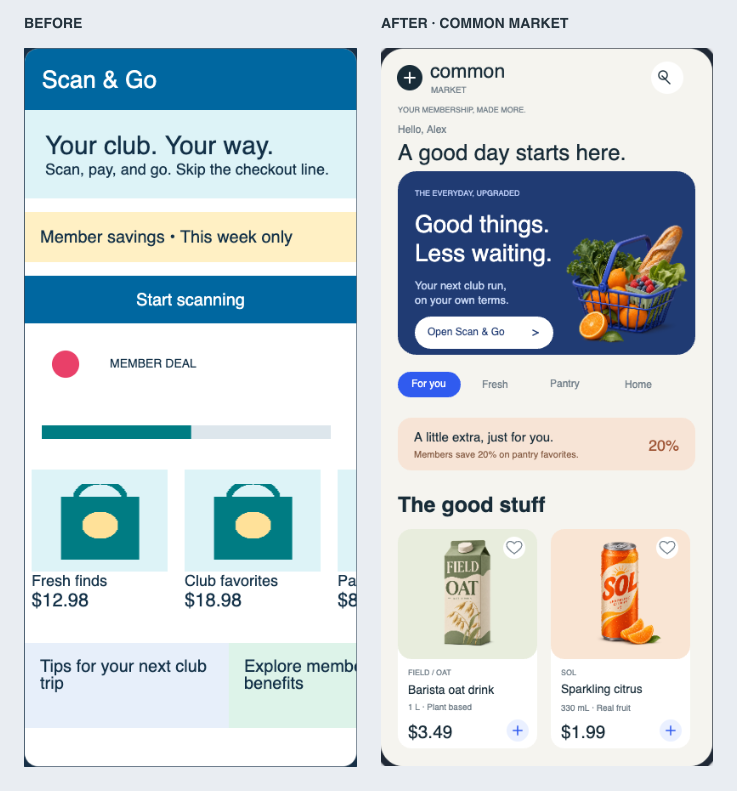

# Visual redesign and rendered review

Reviewed 2026-11-03 (America/New_York). This iteration prioritizes visual composition,
asset quality and authoring-tool clarity. It preserves the pinned protocol architecture
and both installed generic mobile players.

## What changed visually

The editor now has a compact branded workbench, image-first asset gallery, distinct
component glyphs, ordered layer list, quiet gridded canvas and structured inspector with
image targets/previews. Compilation details are secondary; actual errors remain visible.
The artwork is browsable, searchable, insertable and replaceable in both known and custom
primitive trees. JSON remains editable; large documents highlight only visible lines to
avoid mounting thousands of colored DOM spans on each edit.

The mobile page is the fictional Common Market: branded masthead, a personal greeting,
editorial Scan & Go feature with original fresh-market artwork, member offer, distinct
product packaging/prices, horizontally scrolling product/story collections and subtle
member animations. Real image silhouettes, typography, content hierarchy, density and
proportions were reconsidered together. It is not a whole-screen bitmap.

[Design tokens and conventions](DESIGN_SYSTEM.md),
[artwork and exact prompts](../assets/PROVENANCE.md),
[primitive source](../samples/retail-home.json).

## Actual screenshot iterations

1. Captured the previous editor and rendered mobile canvas before changes.
2. First new render exposed hero art crowding text and unequal image destination bounds.
   Reduced/repositioned the hero and corrected image aspect ratios.
3. Native screenshots exposed a colored emoji arrow inconsistent with the icon system;
   replaced it with protocol line drawing.
4. Found incorrect CSS-style padding assumptions. Corrected Remote Compose start/top/end/
   bottom arrays, eliminating vertical carousel padding that clipped prices.
5. Reviewed final browser, Android and iOS screenshots, including scrolled collections,
   product images, vectors and lower-page animation areas. Acceptance was based on these
   visible results as well as automated checks. This is an engineering visual review,
   not an independent professional-design or accessibility certification.

[Editor before](evidence/redesign/editor-before.png) ·
[Editor after](evidence/redesign/editor-final.png) ·
[390px layout](evidence/redesign/editor-390.png) ·
[Tablet](evidence/redesign/editor-768.png) ·
[iOS top](evidence/redesign/ios-top.png) ·
[iOS scrolled](evidence/redesign/ios-scrolled.png) ·
[Android scrolled](evidence/redesign/android-scrolled.png).

## Rendering repairs and measured checks

The prior SVG failure was an adapter bug: RemotePathBase.getPath returns backing capacity.
Encoding only getSize populated elements eliminates trailing zero commands. The 304-byte
curved heart fixture rendered on all three players; browser center pixel was exactly
RGBA(48,91,239,255). Product outline hearts use the repaired real vector path operations.
Strict SVG validation limits commands/size and rejects non-finite coordinates. Named path
resources and arbitrary SVG import remain outside the enabled subset.

Four original transparent assets are embedded as actual PNG BitmapData; no client asset
registry is added. JVM tests check alpha and actual encoded 640×640 dimensions. Browser
replacement checks compare rendered pixel digests, not just JSON. All new default image
bounds preserve aspect ratio. Raster quality was inspected in native screenshots.

Two actual time-expression animations remain protocol-native. Browser draw calls vary.
Connected-color analysis of native screenshot pairs separately measures the member dot
and progress bar; both change in both players. No CSS/JS/Swift business animation replaces
the engine's expression evaluation. Gesture/host events are checked through real player
input, including iOS XCTest and Android adb/instrumentation.

Results: 80 JVM tests, eight model tests, expanded browser editing/assets/error suite,
Android assembly/unit/lint/connected test, iOS UI test, and original 109-byte/three-pixel
browser baseline pass. Machine-readable results are in [evidence](evidence/redesign/results.json).

## Honest remaining limits

The illustrated document is about 1.97MB; the 109-byte baseline was intentionally tiny.
Assets are embedded once per document but no cross-document fragment cache is implemented.
The gallery has four originals; imported arbitrary images/SVG and asset uploads are not
implemented. Fixed-frame drawing copy can overflow if expanded without adjusting layout.
Native font metrics and host letterboxing are not pixel identical. Press-and-drag scrolling
is supported; the browser player does not wire wheel scrolling. The native debug chrome
is still a generic developer shell. The basic raw JSON editor is not a full IDE. Physical
devices, signed iOS packaging and exhaustive accessibility/performance remain unverified.

Next visual work should be a presentation-machine review, larger asset set, typography/
long-copy and accessibility checks, and optional generic debug-shell presentation polish.
Do not change protocol pins or add native business widgets to work around visual issues.
