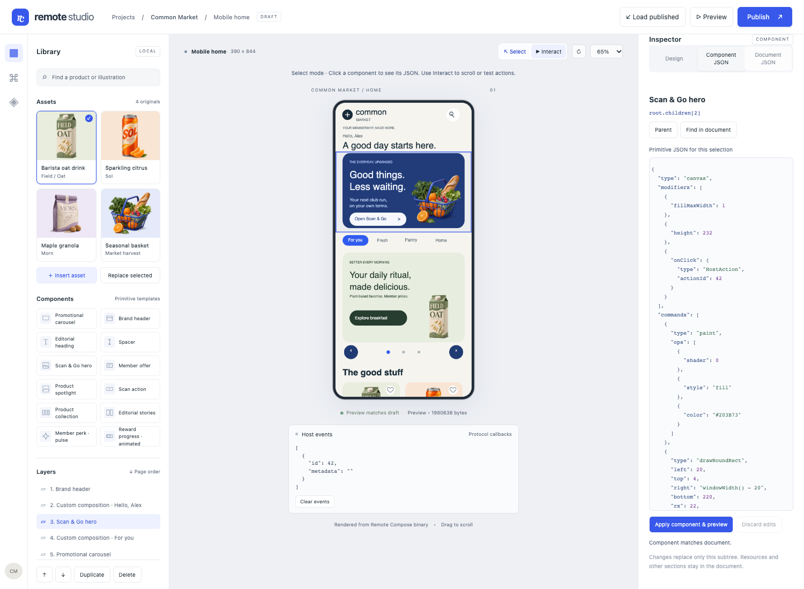
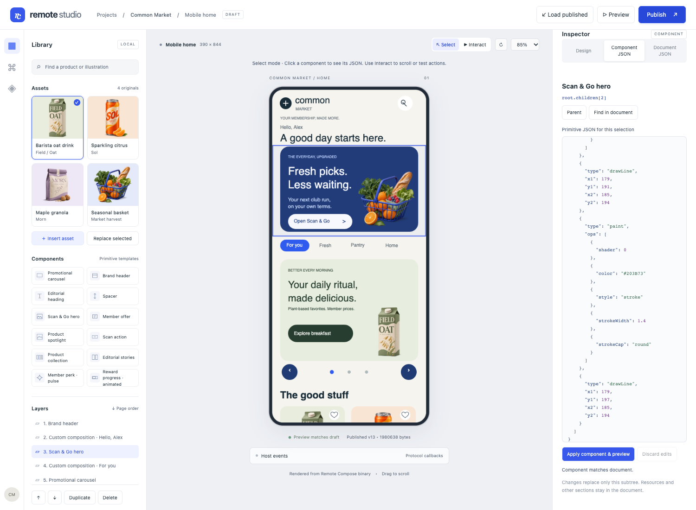
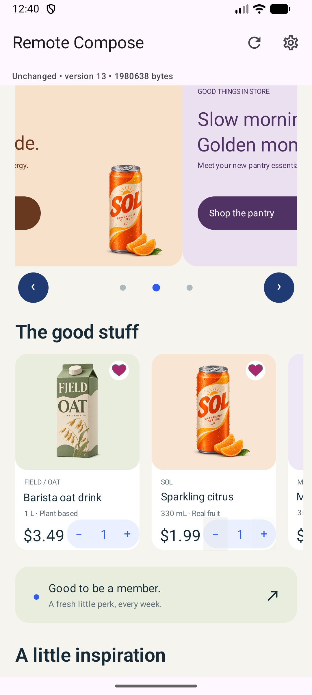
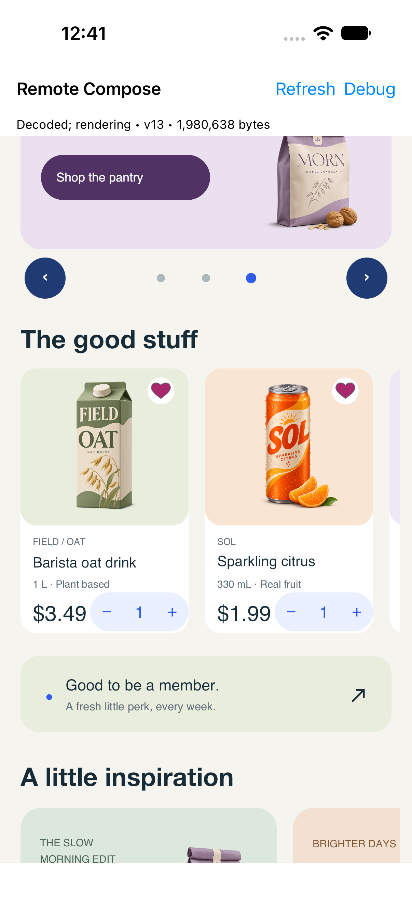

# Component selection and native regression — 2026-11-04

[Proof and native event logs](proof.json) · [selection checks](selection-results.json) ·
[nine unchanged pixel baselines](baseline-results.json).

## Select a component and inspect its primitive JSON

Choose Select, click a component, edit Component JSON, then Apply component & preview.
Use Interact to scroll or run actions. Find in document selects the exact full-source range.
This outline is editor chrome; the phone content remains genuine binary rendering.

## Publish a scoped edit to the unchanged clients

The hero headline changed from “Good things.” to “Fresh picks.” through Component JSON.
All other subtrees remain unchanged. Browser, Android and iOS consumed publication13 from
the isolated8092 test backend:1,980,638 bytes, SHA-256
`c3e96414df541d94e1fdc80c2674efda5bbd20feb6b33b27ed81a33d80fd6238`.
Each native test verified the full digest and27 expected retail events. Client build hashes
before/after publication and execution are identical. No native source or protocol change.

| Browser binary preview | Android Emulator | iOS Simulator |
| --- | --- | --- |
|  |  |  |

Native product states after real input:

| Android | iOS |
| --- | --- |
|  |  |

Original full-screen captures are preserved, including native chrome. Different font metrics
and viewport sizes are expected; this is not a claim of pixel parity. The live8080 publication
was untouched, native apps were returned to8080, and the prior test binding was restored.

## Known limitation found during testing

[zindex-repro.json](zindex-repro.json) draws overlapping red/blue canvases. In the pinned
browser player, blue renders over the earlier red canvas despite red's zIndex2. The selection
test verifies the actual blue pixel and chooses its source node. LayoutComponent reads
ZIndexModifier.mValue, but that modifier supplies mCurrentValue/getValue; mZIndex stays0.
This existing renderer defect was not changed or concealed. Native parity for this specific
reproduction has not been tested. See the [full report](../../FULL_FEATURE_TEST_REPORT.md).
