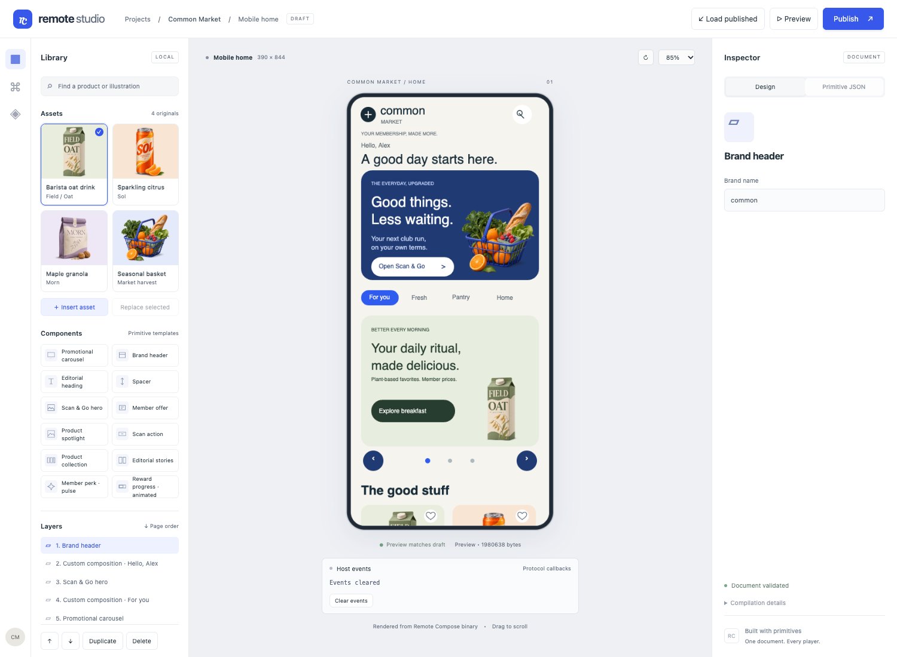
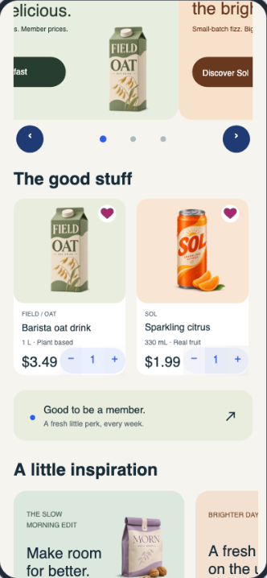
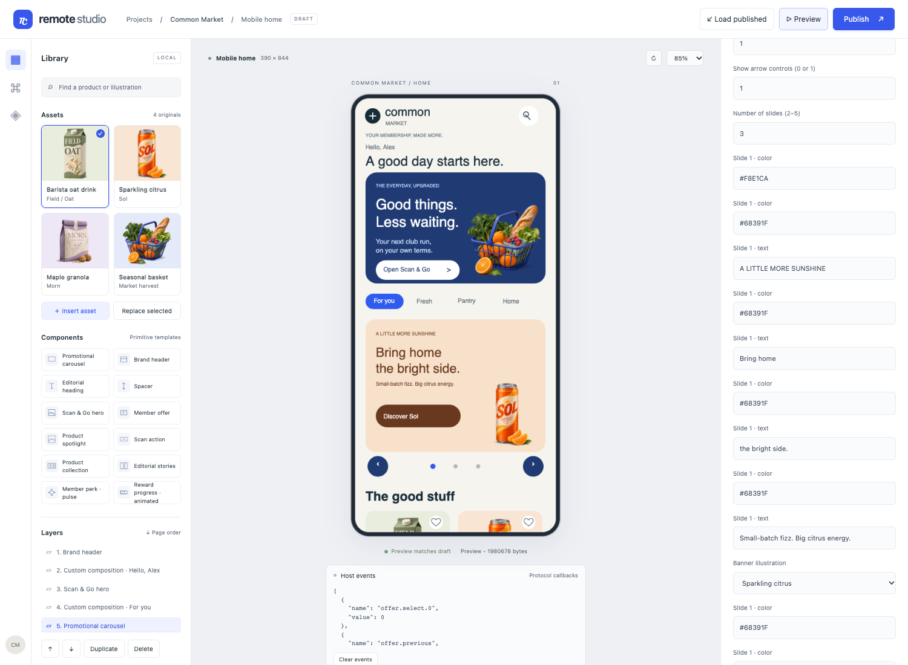
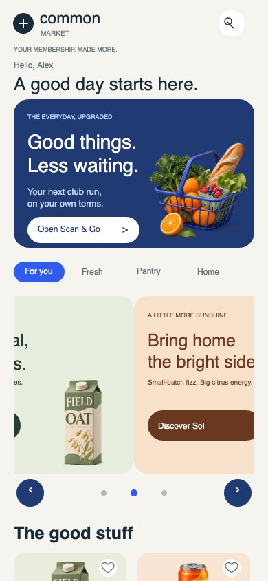
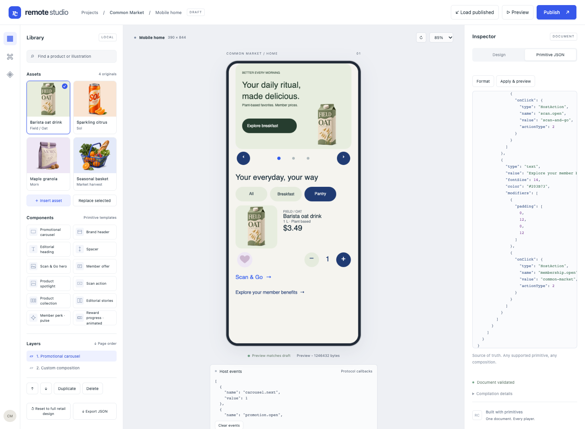

# Editor acceptance evidence — 2026-11-04

Actual Chrome editor interactions, Kotlin compilation, immutable publication and upstream
browser-player rendering. This is a fresh browser/backend run; native evidence is historical.
Base revision `aac2c0e` plus the source/test changes committed alongside this evidence.

Run `sh scripts/verify-editor.sh` with the prerequisites in
[Getting started](../../GETTING_STARTED.md). The full local output is under
`artifacts/editor-acceptance/`; `latest.json` identifies the last completed run. A private
random-port backend isolates publications from the running demonstration.

- [Portable proof, all ten stages and 30 binary hashes](proof.json)
- [76 property edits](editor-results.json), [21 lifecycle cases](lifecycle-results.json),
  [18 complete custom trees](custom-preservation.json)
- [Carousel configuration/behavior](carousel-results.json), [full retail 27 events](retail-proof.json),
  [raw JSON lifecycle](raw-json-proof.json), [37-event local-state stress](stress-proof.json)
- [Responsive/scroll/keyboard observations](usability.json), [nine static golden results](baseline-results.json)
- [Defect and initial test failures](regression.json)

## Rendered screenshots

Full retail editor after actual compilation:

Favorites independently filled and quantity controls visible after real player input:

Edited full-page carousel inspector and a deterministic mid-slide frame (4.775 seconds).
The partial banners in the second image are intentionally clipped during the slide:

Arbitrary primitive JSON fixture, distinct from the bundled full retail design:

[390px editor](editor-390.png), [graphics](graphics.png), [bitmaps](bitmaps.png),
[lifecycle/custom nesting](lifecycle.png). The bitmap gallery intentionally includes
compressed/stretched aspect-ratio cases; they are not the proportions used in retail cards.

## Baseline provenance and limits

The [browser baseline manifest](baseline/manifest.json) reuses the existing historical PNGs.
Graphics, bitmaps, layouts and empty document hashes are unchanged. The five deterministic
phase hashes changed before this task when fixed coordinates became responsive window-width
expressions; their old/current hashes are recorded. All nine current screenshots are pixel
identical to the old images, without changing thresholds. A deliberately wrong fixture hash
was rejected in an isolated negative check. Native baselines were not changed or rerun.

Pointer drag and touch scroll work; synthetic wheel does not scroll the Remote Compose
canvas. Real trackpad, Safari/Firefox, native reruns, screen readers and physical devices
were not exercised here. The editor has no undo/redo. ID-bearing sections reject unsafe
duplication; independent copies require explicit variable renaming. Canvas semantics and
keyboard input remain a player limitation. See the [full report](../../FULL_FEATURE_TEST_REPORT.md).
