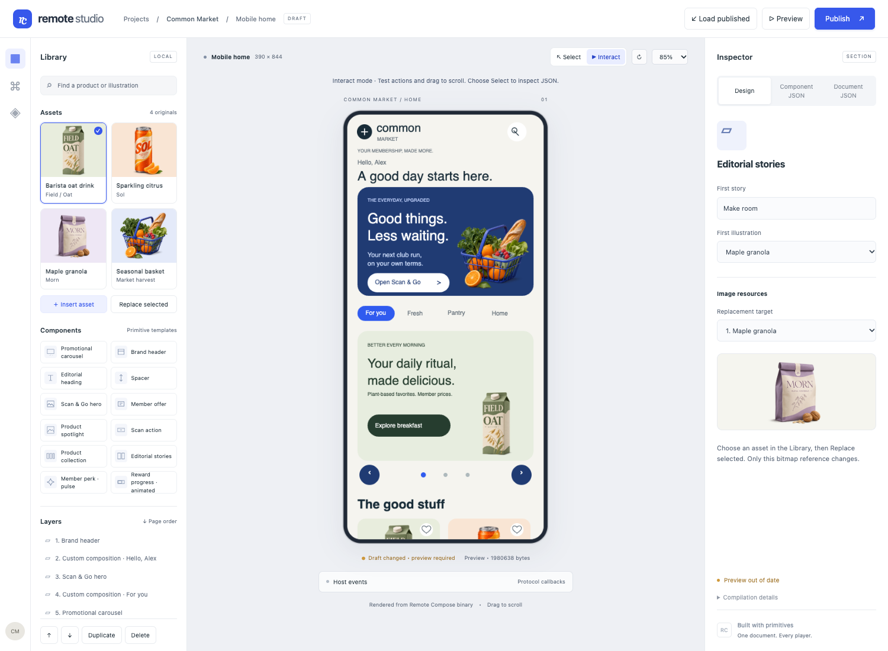
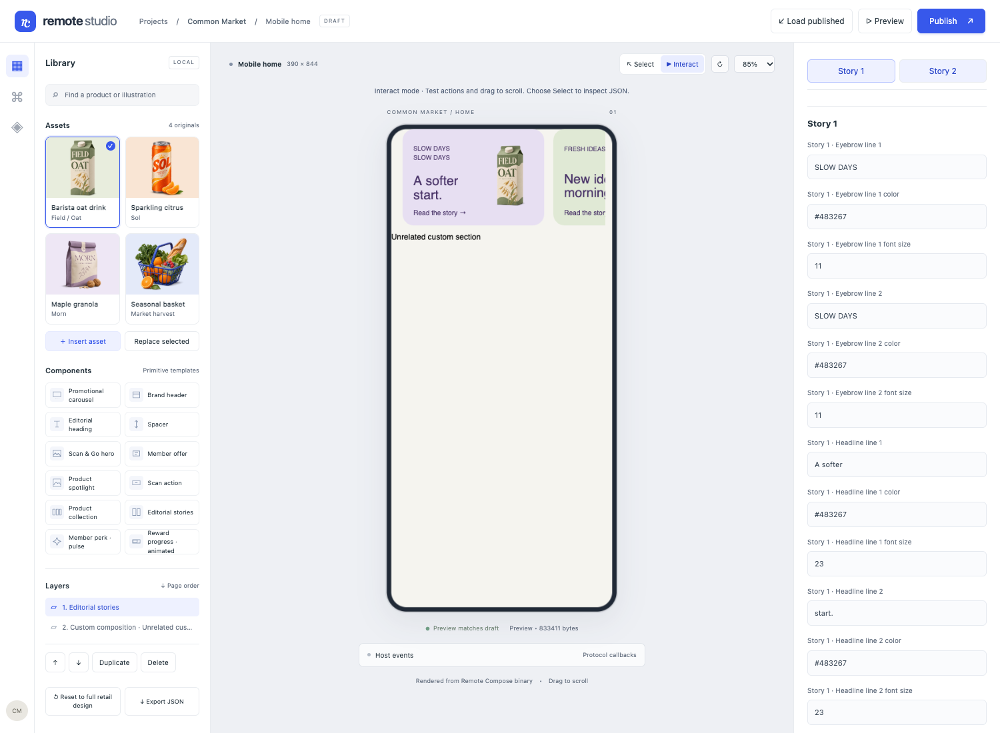
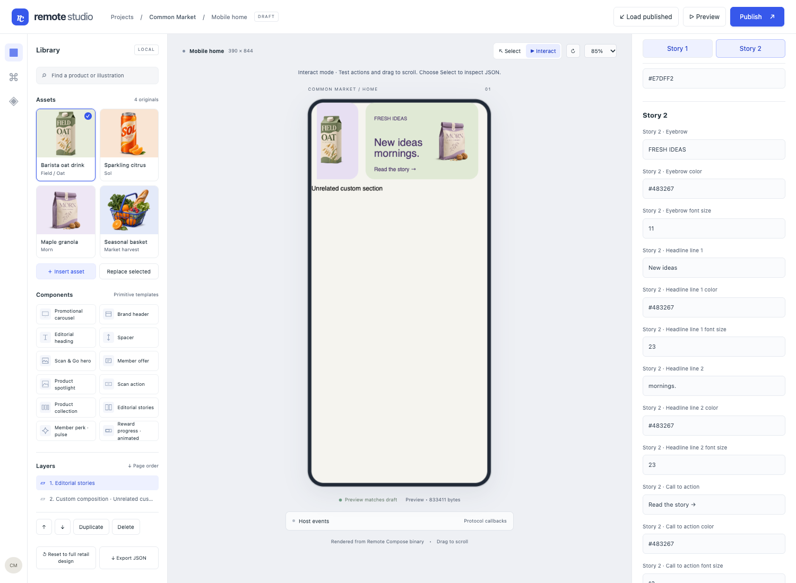

# Editorial stories inspector fix — 2026-11-04

The original inspector offered just one headline line and one illustration for Story1.
Other text/style fields and the second tile were missing from its authoring descriptors.

Both existing tiles now expose every visible text line, illustration, background color,
text color and font size. The31 controls are grouped under Story1 and Story2, with shortcuts
at the top of the inspector. These are field descriptors for the existing primitive objects;
the emitted default document has not been redesigned or regenerated.

Use Layers → Editorial stories → Design, then Story1 or Story2. Preview recompiles edits.
To inspect the second rendered tile, choose Interact and drag the story row horizontally.
Layout geometry and custom commands remain available in Component JSON/Document JSON.

The regression independently checks the drawing operations for missing controls, rather
than only iterating the descriptor list. The real browser test edits the bundled design,
checks exact unrelated-source preservation, verifies JSON round trips and uses a pointer
drag to expose the second tile. It also checks the palette-created version.

See the [full report](../../FULL_FEATURE_TEST_REPORT.md) for results and validation scope.

## Verified results

`sh scripts/verify-editor.sh`: 20 Node tests, all 12 browser acceptance stages,
105 template property edits, 30 compiled/rendered fixtures and 9/9 reviewed browser
goldens pass (zero pixel differences). The dedicated test edited all 31 story fields.
See [field-by-field results](results.json) and [suite proof and binary hashes](proof.json).
JVM tests were UP-TO-DATE; no native tests were rerun for this authoring-only change.

Screenshots use the same edited subtree from the bundled full-page test, placed at the
top beside a custom section so both tiles can be inspected. The full page was compiled
before this focused view. The first tile peeking in the second image is intentional
horizontal scrolling. Text remains positioned drawing content, not auto-wrapping text;
longer copy or larger fonts may require geometry edits in JSON.
